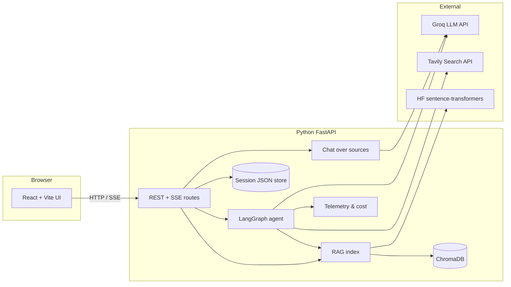
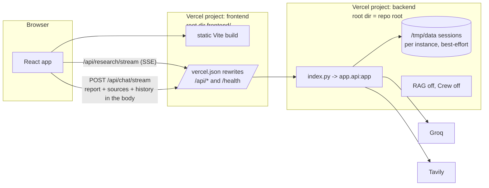
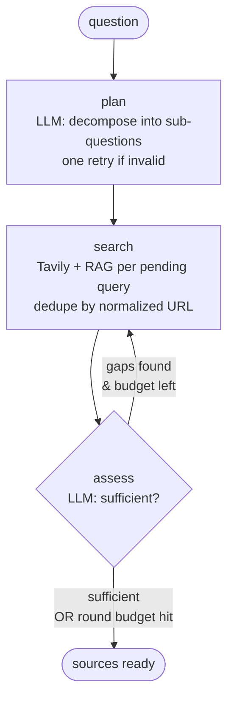
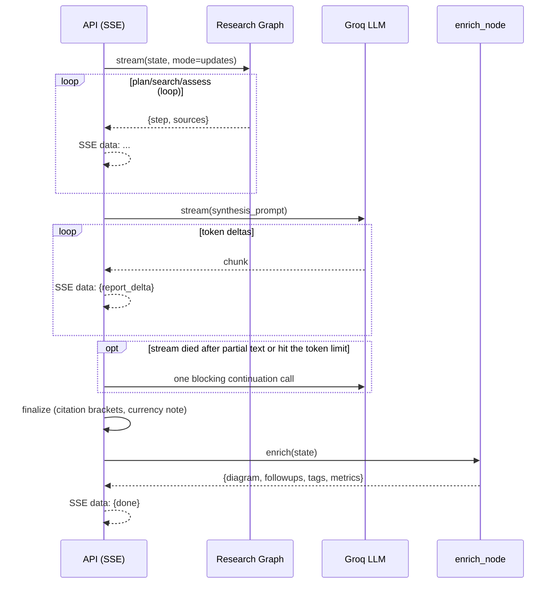
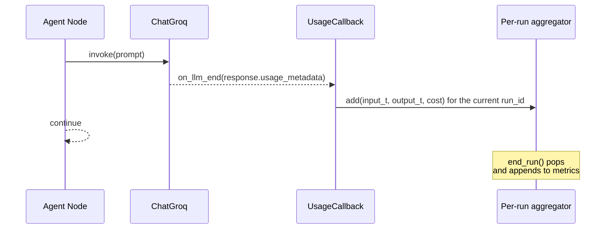
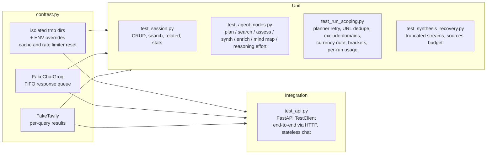

# Architecture

A design-focused companion to [README.md](README.md). Explains **what the
pieces are, how they fit, and why the tradeoffs came out this way** —
written so someone unfamiliar with the codebase can grok the system in
ten minutes.

---

## System topology

The full stack (Docker or local):



### Hosted deployment (Vercel)

The hosted demo is two Vercel projects built from this one repo. It runs
a reduced feature set because of Vercel's function limits.



- **Frontend project** — root directory `frontend/`. [frontend/vercel.json](frontend/vercel.json)
  rewrites `/api/:path*` and `/health` to the backend project, so the
  browser only talks to its own origin.
- **Backend project** — root directory is the repo root. [index.py](index.py)
  re-exports the FastAPI `app`; the slim [requirements.txt](requirements.txt)
  keeps the bundle small (the full dependency list lives in
  `requirements-full.txt`); [.vercelignore](.vercelignore) trims the rest.
- **Reduced feature set** — when the `VERCEL` environment variable is
  set, [app/config.py](app/config.py) defaults `ENABLE_RAG` and
  `ENABLE_CREW` to off and puts data under `/tmp/data`.
- **Sessions are best-effort** — `/tmp` belongs to one running instance,
  so a saved session can be missing when a later request lands on another
  instance. Follow-up chat therefore does not depend on the session store:
  `POST /api/chat/stream` takes the question, report, sources and chat
  history in the request body (see *Lessons from running it live*).
- **Round budget** — `MAX_ROUNDS` defaults to 3 in `config.py` and there
  is no Vercel-specific override in the code, so a hosted run uses the
  same default unless the variable is set in the project's settings. A run
  also has to finish inside the platform's function duration limit
  (documented as 300 s on the Hobby plan in [DEPLOY.md](DEPLOY.md)).

---

## The research pipeline

The interesting part. Two graphs cooperate.

### Graph 1: `build_research_agent` — plan + search + assess loop



- **Plan** — asks the LLM for up to `MAX_SUBQUESTIONS` (default 4)
  sub-questions as a JSON array. If the answer is invalid or has fewer
  than `min(2, MAX_SUBQUESTIONS)` entries, it retries once with a
  corrective note appended to the prompt, then falls back to searching the
  original question. If every model fails, it also falls back to the
  original question.
- **Search** — one Tavily query per pending query (`RESULTS_PER_SEARCH`,
  default 4, `search_depth="advanced"`). The `EXCLUDE_DOMAINS` setting
  (default `youtube.com,youtu.be`) is passed to Tavily as `exclude_domains`
  when it is non-empty. A failed query is skipped, not fatal.
- **Deduplication** — sources are deduplicated on a normalized URL before
  they are numbered: lowercase host, `www.` stripped, trailing slash,
  query string and fragment ignored (`_normalize_url`). Loops don't pile
  up the same source, and numbering stays stable across rounds.
- **RAG is transparent** — when `ENABLE_RAG` is on, hits from ChromaDB
  flow into the same source list, tagged `source_type: "document"` so the
  UI can badge them.
- **Assess** — once `MAX_ROUNDS` (default 3) is reached it stops
  asking for more; otherwise the LLM may queue follow-up queries.
  **Termination is guaranteed** by `MAX_ROUNDS` — even if the assessor
  keeps flagging gaps forever, the loop can't run more than N times.

`build_full_agent` adds `synthesize` and `enrich` nodes after the loop; it
backs the blocking `run_research` entry point (`POST /api/research`).

### Graph 2: streaming synthesis, driven outside the graph



Why split it? LangGraph nodes are atomic — you can't easily yield
tokens **from inside** a node while the graph is running. So the graph
runs up to "coverage sufficient", `stream_research()` then streams
synthesis manually with `llm.stream()`, then runs the enrich node.

What happens around the stream (all in [app/agent.py](app/agent.py)):

- **Prompt** — `_build_synthesis_prompt` combines the template rules,
  today's date, a short list of additional rules, and the sources block.
  The sources block is capped by `SYNTH_CONTEXT_CHARS` (default 12000),
  split evenly across sources with at most 1200 and at least 100
  characters each; every source keeps its number.
- **Truncation recovery** — if the stream dies after partial text, or a
  chunk reports `finish_reason == "length"`, `_complete_report` makes one
  blocking call (through the same model chain) asking the model to
  continue exactly where the text stops. If that fails, the report ends
  with a visible "cut off" note.
- **Everything-failed fallback** — if no model produces any text,
  `_salvage_report` emits a source-only report so the run still returns
  something useful.
- **Finalizing** — `_finalize_report` normalizes `【n】`, `［n］` and `〔n〕`
  to `[n]`, strips any model-written "Currency note:" line, and adds the
  note itself under the first paragraph when the question matches
  `FAST_CHANGING_KEYWORDS`.
- **Enrichment** — a mind map (labels are sanitized by `_sanitize_mindmap`
  and the result is discarded unless it starts with `mindmap`), follow-up
  questions, tags and metrics.

---

## Key design decisions

### Why LangGraph over plain LangChain chains
- **Cycles**: the "search until sufficient" loop is the whole point;
  chains are DAGs.
- **Explicit state**: the `ResearchState` TypedDict is the contract
  between nodes; easy to unit-test one node in isolation with a stub
  state (see [tests/test_agent_nodes.py](tests/test_agent_nodes.py)).
- **Deterministic routing**: `route_after_assess_full` and
  `route_after_assess_research_only` are pure and testable.

### Why streaming synthesis outside the graph
LangGraph's `stream()` yields **per-node updates**, not intra-node
token deltas. Streaming synthesis inside a node would require a
callback + queue plumbing that isn't worth the complexity. Splitting
into a research-only graph + external synthesis kept the graph pure and
the streaming code obvious.

### Why JSON files for sessions instead of SQLite
- One file per session, fully diffable, zero migration cost, trivial to
  inspect during development.
- Sessions are read-mostly and single-user for a portfolio project.
  SQLite would be overkill and add a schema.
- `session.py` exposes CRUD-style helpers (`save_session`, `get_session`,
  `list_sessions`, `delete_session`, ...), so a different store would be
  confined to that module.
- On Vercel the files live in per-instance `/tmp`, which is why the hosted
  chat does not rely on them.

### Why ChromaDB (not FAISS / pgvector)
- Persistent by default with no separate server process.
- First-class LangChain integration via `langchain-chroma`.
- Free tier of embedding via `sentence-transformers` (MiniLM) keeps the
  demo runnable without an OpenAI key.
- It is not part of the hosted demo: the dependency stack does not fit
  Vercel's function size limit.

### Why Groq for LLM, and how models are chosen
- Fast inference, so streaming synthesis feels responsive.
- Cost per run is reported from a price table (an estimate, see
  *Known limitations*).
- `_model_chain()` builds the ordered chain: `GROQ_MODEL` first, then the
  comma-separated `GROQ_MODEL_CHAIN`, duplicates dropped. The defaults in
  [app/config.py](app/config.py) are `GROQ_MODEL=openai/gpt-oss-20b` and
  `GROQ_MODEL_CHAIN=openai/gpt-oss-20b,openai/gpt-oss-120b,qwen/qwen3.8-27b`.
- `_invoke_with_fallback` and `_stream_with_fallback` move to the next
  model on a recoverable provider error (rate limit, retired model, 5xx
  and similar; the check is deliberately permissive). Once a stream has
  already produced text they do not restart on another model, because that
  would duplicate the text; the failure is logged and re-raised so the
  continuation step can finish the report.
- `_make_client` passes `reasoning_effort` (the `REASONING_EFFORT` setting,
  default `low`) only to `openai/gpt-oss*` models.
- Follow-up chat uses the same chain through `agent._llm`. Crew mode
  (`app/crew.py`) builds one client from `CREW_MODEL` (default
  `openai/gpt-oss-120b`) with no per-call fallback.

### Why SSE (not WebSockets)
- Research progress is a one-way stream, server -> browser, and fits SSE.
- The research stream uses the browser's built-in `EventSource`, and the
  client never reconnects on its own (see *Lessons from running it live*).
- Follow-up chat needs a request body, and `EventSource` only does GET, so
  [useChat.ts](frontend/src/hooks/useChat.ts) uses `fetch` POST with a
  `ReadableStream` parser and an `AbortController` for stop.

### Why React + Vite (not Next.js)
- Zero server needs on the frontend; it's a static SPA that talks to
  FastAPI. Deploying is `vite build` + serve `dist/`.
- Vite HMR is instant and Tailwind JIT compiles cold in <1s.

### Feature flags for gradual capability degradation
- `ENABLE_RAG` off → RAG code path is skipped without erroring.
- `ENABLE_CREW` off → the blocking Crew endpoint returns 400 and the Crew stream sends an error event.
- Both default to off when the `VERCEL` environment variable is set.
- `GROQ_API_KEY` missing → `config.validate()` raises early with a
  user-friendly `RuntimeError`.

---

## Telemetry & cost

Every LLM call made through `_make_client` carries a LangChain
`BaseCallbackHandler` from [app/telemetry.py](app/telemetry.py)
(`telemetry.callbacks()`):



The callback reads the response's `usage_metadata`, prices it against the
table in `telemetry._DEFAULT_PRICES` (override with `GROQ_PRICE_INPUT` and
`GROQ_PRICE_OUTPUT` together), and adds it to a lock-protected dict keyed by
run id. The current run id comes from a `ContextVar`.

- **`telemetry.bind_run(run_id, generator)`** re-sets that `ContextVar` on
  every step of a generator. `stream_research` is a synchronous generator
  that the server resumes step by step in a fresh copy of the request
  context, so a value set once at the start would otherwise be lost.
- **Usage with no run in scope is discarded.** `get_usage()` and
  `pop_usage()` return a throwaway object when there is no current run id,
  so no shared "unattributed" bucket can mix counts between concurrent
  runs.

Two additional outputs:

1. **Structured logs** — JSONL to stderr **and** to
   `<DATA_DIR>/telemetry/YYYY-MM-DD.jsonl`. Every line has stable fields
   `{ts, level, event, run_id, node, ...}`; grep-friendly, easy to ship
   to Loki later. Events include `run.start`, `research.start` (run id,
   template, question length, the client's `rid`, user agent, referer and
   `X-Forwarded-For`), `llm.call`, `llm.fallback`, `llm.stream_fallback`,
   `llm.stream_midflight_error`, `llm.continuation_failed`, `plan.invalid`
   and `run.end`.
2. **Frontend metrics tile** — the API returns
   `input_tokens / output_tokens / cost_usd / llm_calls` alongside
   duration and source counts; the UI renders them in the metrics bar.

---

## Testing strategy

100 tests across five files; no network calls and no frontend test runner.



- **No network calls in the suite.** Most LLM invocations go through
  `FakeChatGroq`, which pops responses from a per-test queue. Every Tavily
  call goes through `FakeTavily` or a small recording fake. Tests that need
  streams that fail midway or usage callbacks define their own scripted
  fakes.
- **Data is isolated per test** — `SESSIONS_DIR`, `UPLOADS_DIR`,
  `CHROMA_PERSIST_DIR` all point at pytest's `tmp_path`, and the research
  cache and rate limiter are reset.
- **`MAX_ROUNDS=1`** and **`MAX_SUBQUESTIONS=2`** in tests to keep the loop
  deterministic.
- **CI** ([.github/workflows/ci.yml](.github/workflows/ci.yml)) runs pytest
  on Python 3.12 and 3.13 and builds the frontend. Evals are not part of CI.

Run:
```powershell
.\.venv\Scripts\python.exe -m pytest
```

---

## Evals

Separate from unit tests. [`evals/run_eval.py`](evals/run_eval.py) runs
the **real** agent against real APIs and scores each report with an LLM
judge on five 0-5 rubrics (coverage / citations / groundedness /
clarity / honesty). The judge goes through the same model chain as the
agent. See [evals/README.md](evals/README.md).

Evals are run by hand, not in CI. The cost column comes from the same
price table as the metrics tile, so it is an estimate; the sample output
in the evals README is illustrative.

---

## Trade-offs & known gaps

| Chose                                   | Trade-off                                                |
|-----------------------------------------|----------------------------------------------------------|
| JSON files for sessions                 | No concurrent-write protection; on Vercel they sit in per-instance `/tmp`, so saved sessions can disappear or be unreachable (hence stateless chat) |
| ChromaDB embedded                       | No horizontal scale; not available on the hosted demo    |
| SSE unidirectional stream               | Can't pause/rewind synthesis; a dropped stream cannot be resumed, only re-run |
| Groq only, model fallback chain         | Fallback is across models on one provider; a provider-wide outage still ends in a source-only report |
| Price table in code                     | Costs are estimates and drift when prices change; override with `GROQ_PRICE_INPUT` / `GROQ_PRICE_OUTPUT` |
| No auth                                 | Anyone with the URL can use the hosted backend and its API quota; the only guard is an in-memory per-IP rate limit (30/min by default, counted per instance) |
| No observability backend                | Logs are JSONL to disk (and stderr); would ship to Loki in production |
| Streamlit legacy UI kept in `legacy/`   | See below                                                |

**Streamlit legacy UI.** [legacy/streamlit_app.py](legacy/streamlit_app.py)
still exists and calls `run_research` directly. Nothing in the React app or
either deployment uses it: `.vercelignore` excludes `legacy/`, the Dockerfile
copies only `app/`, `evals/` and the docs, and the slim `requirements.txt`
has no `streamlit`. It is still listed in `requirements-full.txt`, so local,
Docker and CI installs pull Streamlit in. `app/api.py` also keeps the older
`/research` and `/research/stream` routes, which the Streamlit file does not
use today. Delete the folder and the dependency if the Python UI is no
longer wanted.

None of these are blockers for a portfolio demo. Each has a short
upgrade path if the project graduates to production.

---

## Lessons from running it live

**No auto-reconnect.** The research stream has no resume cursor, so any
reconnect starts a whole new run. The old client retried after a dropped
connection, which was the only code path that could start a second run on
its own. The client now closes the stream on `done`, on an error, and once
the report has arrived, and never reconnects. `start()` also ignores a call
while a run is in progress, or for the same question, template and mode
within 90 seconds, unless the caller passes `force`. Each request carries a
client-generated `rid`, and `research.start` logs it with the request
headers so a duplicate can be traced.

**Stateless chat.** Sessions live in per-instance `/tmp` on Vercel, so
follow-up chat on a saved report could land on an instance without it and
fail with "Session not found". `POST /api/chat/stream` takes the question,
report, sources and recent history from the browser and never reads or
writes the session store. The server caps the body at 200 KB, the report at
4000 characters, sources at about 12000 characters and history at the last
6 turns. The session-based chat routes remain for persistent deployments;
the cost is that the stateless route does not save chat turns.

**Post-process in code, not in prompts.** A prompt rule asking the model to
add a currency note only for fast-changing topics was unreliable, so the
note is now added by code from a keyword list, and any model-written copy is
stripped first. The same goes for citation brackets: fullwidth `【n】` style
brackets are normalized to `[n]` in the final report and again when the
frontend links citations. The size of the sources block is capped by
`SYNTH_CONTEXT_CHARS` instead of trusting per-source truncation, to stay
under the provider's per-minute token limit.

**Truncated streams.** A Groq stream could end mid-sentence ("Streaming
ended early … using partial"). Worse, the model fallback used to restart
on the next model after text had already been sent, which could duplicate
it. Now a stream that has produced text is never restarted. Instead the
partial report goes into one continuation call, and if that also fails the
report ends with a visible "cut off" note.

**Reasoning effort for gpt-oss.** The gpt-oss models spend hidden reasoning
tokens that inflate token counts, latency and the chance of truncation.
`REASONING_EFFORT` (default `low`) is sent only to `openai/gpt-oss*` models
and is ignored for others such as qwen; an empty value turns it off.

**Per-run usage scoping.** Usage and call counts are tracked per run id
read from a `ContextVar`. Because the server resumes the streaming generator
in a fresh context each step, the run id set at the start was gone on later
steps, so callbacks fell into a shared bucket and concurrent runs could
report each other's usage or zero. `telemetry.bind_run` now re-attaches the
run id on every step, and usage with no run in scope is discarded. A test
runs two research runs concurrently in fresh contexts and checks each
reports only its own call count; it fails without the fix.

---

## Known limitations

- **Figures can vary between runs.** The same question can produce
  different numbers and sources.
- **Recent news and tool comparisons can be out of date.** Results depend
  on what the search returns, and "best in a given year" style questions in
  particular can be wrong. The currency note is a keyword heuristic, not a
  check of source dates.
- **Legal topics can be wrong.** The output is not legal advice.
- **Cost figures are estimates** computed from the price table in
  `telemetry.py`, not from billing data.
- **The hosted demo is reduced:** no document upload (RAG), no Crew mode,
  best-effort session history, and a single run has to finish within the
  platform's function limit.

---

## Where to look for what

| I want to…                                | Read this                                           |
|-------------------------------------------|-----------------------------------------------------|
| Understand the agent loop                 | [app/agent.py](app/agent.py) — `build_research_agent` |
| See what a node returns                   | [tests/test_agent_nodes.py](tests/test_agent_nodes.py) |
| Add a new report template                 | `TEMPLATES` in [app/agent.py](app/agent.py)          |
| Add a new API endpoint                    | [app/api.py](app/api.py)                            |
| Add a UI component                        | [frontend/src/components/](frontend/src/components/) |
| See how the client streams a run          | [frontend/src/hooks/useResearch.ts](frontend/src/hooks/useResearch.ts) |
| See how follow-up chat streams            | [frontend/src/hooks/useChat.ts](frontend/src/hooks/useChat.ts) and `stream_stateless` in [app/chat.py](app/chat.py) |
| Track LLM tokens / cost                   | [app/telemetry.py](app/telemetry.py)                |
| Measure the agent's quality               | [evals/run_eval.py](evals/run_eval.py)              |
| Change loop budgets                       | `MAX_ROUNDS` / `MAX_SUBQUESTIONS` in [app/config.py](app/config.py) |
| Change models or fallback order           | `GROQ_MODEL` / `GROQ_MODEL_CHAIN` in [app/config.py](app/config.py) |
| Deploy to Vercel                          | [DEPLOY.md](DEPLOY.md)                              |
